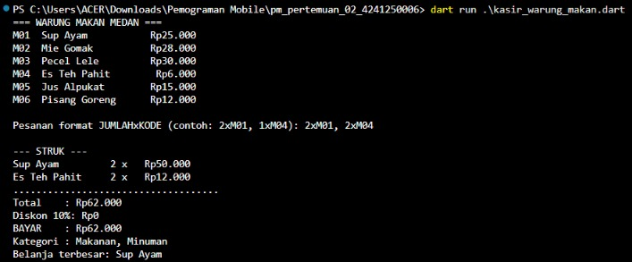

# pm-pertemuan-02-4241250006

Nama: Ananda Syafika | NIM: 4241250006 | Kelas: PSIK 24D

## Deskripsi
Tugas Rutin 2: Kasir Console (Warung Makan Medan). Program Dart console yang
menampilkan daftar menu, membaca pesanan dalam satu baris (format `JUMLAHxKODE`,
dipisah koma), lalu mencetak struk berisi total, diskon 10% untuk belanja
minimal Rp100.000, total bayar, kategori yang dibeli, dan item dengan belanja
terbesar. Pesanan dengan kode atau jumlah yang salah diabaikan dan ditampilkan
di baris `Diabaikan`, program tidak crash.

File: `kasir_warung_makan.dart`

## Cara Menjalankan
```powershell
dart run .\kasir_warung_makan.dart
```

## Skenario Uji

### Skenario 1: total di bawah Rp100.000 (tanpa diskon)
Input: `2xM01, 2xM04`

```text
--- STRUK ---
Sup Ayam         2 x   Rp50.000
Es Teh Pahit     2 x   Rp12.000
....................................
Total    : Rp62.000
Diskon 10%: Rp0
BAYAR    : Rp62.000
Kategori : Makanan, Minuman
Belanja terbesar: Sup Ayam
```



### Skenario 2: total di atas Rp100.000 (dapat diskon 10%)
Input: `8xM03, 8xM05`

```text
--- STRUK ---
Pecel Lele       8 x  Rp240.000
Jus Alpukat      8 x  Rp120.000
....................................
Total    : Rp360.000
Diskon 10%: Rp36.000
BAYAR    : Rp324.000
Kategori : Makanan, Minuman
Belanja terbesar: Pecel Lele
```


### Skenario 3: ada pesanan yang salah
Input: `2xM02, 3xM99, abc, 1xM05`

```text
(tempel output asli dari terminal di sini)
```


## Penjelasan

### var, final, dan const
- `const` dipakai untuk nilai yang sudah pasti saat kompilasi dan tidak pernah
  berubah: `batasDiskon`, `persenDiskon`, dan `daftarMenu`. Isi `daftarMenu`
  juga ikut tidak bisa diubah.
- `final` dipakai untuk variabel yang nilainya baru diketahui saat program
  berjalan dan hanya diisi sekali: `input`, `pesanan`, `diabaikan`, `total`,
  `diskon`. Perhatikan `pesanan` adalah `final` tetapi isinya masih bisa
  ditambah dengan `add`. Yang dikunci adalah referensinya, bukan isi list.
- `var` dipakai bila variabel perlu diganti nilainya. Di program ini semua
  variabel cukup `final` atau `const`, jadi tidak ada yang memakai `var`.

### Null safety
- `stdin.readLineSync()` bisa mengembalikan `null` (misalnya input ditutup).
  Ditangani dengan `?? ''` sehingga hasilnya selalu `String`.
- `int.tryParse(...)` mengembalikan `int?`. Bila teksnya bukan angka, hasilnya
  `null` dan pesanan dimasukkan ke daftar `diabaikan`.
- `daftarMenu[kode]` mengembalikan `Hidangan?` karena kode bisa tidak ada di
  Map. Hasilnya dicek `item != null` sebelum dipakai.
- Operator `!` (null assertion) **tidak dipakai** di program ini. Operator itu
  memaksa Dart menganggap nilai tidak null dan akan melempar error saat runtime
  jika ternyata null, jadi lebih aman memakai pengecekan `!= null` atau `??`
  seperti di atas.

### Fitur Dart yang dipakai
- Record dan `typedef` (`Hidangan`, `Baris`) untuk data menu dan baris pesanan.
- Pattern matching list (`case [final j, final k]`) agar hanya teks berbentuk
  `jumlah x kode` yang diproses.
- `map`, `fold`, `reduce`, dan `toSet` untuk menghitung total, item terbesar,
  dan kategori unik.
- `extension Rupiah on int` untuk format angka ke `Rp25.000`.

## Kendala dan Solusi
1. **Kendala:** (isi dengan kendala yang benar-benar Anda alami)
   **Solusi:** (isi solusinya)

## Pernyataan Penggunaan AI
(Tulis sesuai kondisi sebenarnya: bagian mana yang dibantu AI, bagian mana yang
Anda kerjakan sendiri, dan bahwa Anda memahami kode yang dikumpulkan.)